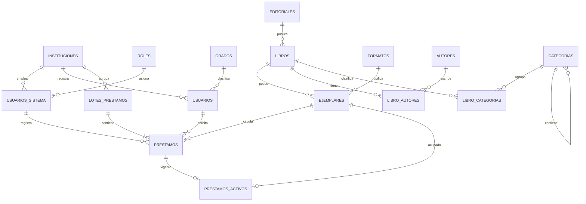

# Diseño de base de datos — Biblioteca Virtual ST

> Documento de diseño aprobado. Deriva de `PROJECT.md`, `SCOPE.md`,
> `REQUIREMENTS.md`, `UI_SPECIFICATION.md` y `ARCHITECTURE.md`, siguiendo el
> encargo de `DATABASE_DESIGN_BRIEF.md`. El esquema SQLite se encuentra en
> `database/01_schema.sql`; la aplicación inicializa el resto de datos localmente.

## 0. Decisiones aprobadas

Las siguientes decisiones técnicas fueron aprobadas por el responsable del
proyecto y se aplican en el esquema:

| # | Tema | Decisión |
|---|---|---|
| 1 | Taxonomía | Tabla única `categorias` con campo `tipo` (`genero`/`categoria`/`tema`) y jerarquía opcional (`padre_id`) |
| 2 | Autoría | M:N — un título puede tener varios autores (`libro_autores`) |
| 3 | Editorial | 1:N — un título tiene una editorial |
| 4 | "Usuario responsable" (RF04) | Se guardan ambos: `usuario_id` (quien recibe) y `registrado_por` (quien registra) |
| 5 | Institución | Tabla `instituciones` (permite varias sedes sin romper el modelo); seed con una fila |
| 6 | Devoluciones | Un solo evento de devolución por préstamo (campos en `prestamos`); sin renovaciones por ahora |
| 7 | Grado escolar | Catálogo `grados` |
| 8 | Tipo de usuario | Campo `usuarios.tipo_usuario` (estudiante/docente/administrativo) |
| 9 | Formato | Catálogo `formatos` |
| 10 | Campos extra propuestos | Aprobados (`subtitulo`, `anio_publicacion`, `idioma`, `descripcion`, `ubicacion`, `tipo_documento`, `nota_devolucion`) |
| 11 | Unicidad de usuarios | `documento` y `correo` únicos (correo admite NULL) |
| 12 | Baja | Borrado lógico para títulos y ejemplares; el personal puede eliminarse físicamente si se conserva el historial de préstamos mediante `registrado_por=NULL`. |
| 13 | Parámetros iniciales | `dias_prestamo=7`, `limite_ejemplares=3`, `dias_alerta_vencimiento=3` |
| 14 | Mora | Se calcula, no se persiste |
| 15 | Bloqueo por mora | No se implementa en el esquema (queda como decisión de aplicación) |
| 16 | Auditoría | No se incluye tabla de auditoría (fuera de requisitos) |
| 17 | Motor | SQLite local mediante PDO SQLite |
| 18 | Aislamiento institucional | Los registros operativos y catálogos pertenecen a una institución; las claves foráneas compuestas evitan asociar libros, préstamos y cuentas de otra institución. |
| 19 | Condición física | Cada ejemplar almacena su condición (`bueno`/`intermedio`/`arreglar`) separada de su estado de circulación. Los ejemplares en arreglo no se ofrecen para préstamo. |
| 20 | Eliminación de personal | `prestamos.registrado_por` admite `NULL`; al eliminar personal, la aplicación lo limpia antes del borrado para conservar el historial y la clave foránea compuesta de aislamiento. |
| 21 | Eliminación institucional | La aplicación elimina en una transacción los datos de la institución en orden de dependencia, después de solicitar confirmación. |
| 22 | Préstamos agrupados | `lotes_prestamos` agrupa los ejemplares registrados en una misma operación; cada ejemplar conserva su estado y devolución individual en `prestamos`. |
| 23 | Préstamos activos | `prestamos_activos` registra solo los préstamos vigentes. Su clave primaria por institución y ejemplar impide duplicar un préstamo activo sin usar una columna generada; `prestamos` conserva el historial completo. |

---

## 1. Entidades y responsabilidades

| # | Entidad | Origen | Responsabilidad |
|---|---|---|---|
| 1 | `instituciones` | UI §5, §6.3 | Datos de la sede/entidad educativa y logotipo |
| 2 | `roles` | RF01, SCOPE §3 | Catálogo de roles (Administrador, Bibliotecario) |
| 3 | `usuarios_sistema` | RF01, UI §6.2 | Personal con login (admin/bibliotecario) |
| 4 | `usuarios` | RF03 | Usuarios institucionales que reciben préstamos |
| 5 | `grados` | RF03, UI §3 | Catálogo de grados escolares (filtro) |
| 6 | `autores` | RF02, SCOPE §1 | Autores del catálogo, aislados por institución |
| 7 | `editoriales` | RF02, SCOPE §1 | Editoriales del catálogo, aisladas por institución |
| 8 | `categorias` | SCOPE §1, UI §4 | Taxonomía (género / categoría / tema), aislada por institución |
| 9 | `formatos` | RF02 ("formato") | Formato físico del ejemplar, aislado por institución |
| 10 | `libros` | RF02 | **Título bibliográfico** (dato común), aislado por institución |
| 11 | `ejemplares` | RF02, RF05, brief punto 4 | **Copia física** con código de barras y disponibilidad, aislada por institución |
| 12 | `libro_autores` | RF02 | Puente M:N libro↔autor |
| 13 | `libro_categorias` | SCOPE/UI | Puente M:N libro↔categoría |
| 14 | `lotes_prestamos` | RF04 | Agrupa los ejemplares de un movimiento |
| 15 | `prestamos` | RF04, RF05 | Detalle de circulación + devolución por ejemplar |
| 16 | `prestamos_activos` | RF04, RF05 | Referencias de préstamos vigentes, con unicidad por ejemplar |
| 17 | `configuraciones` | RF06, RNF05, UI §6.1 | Parámetros editables sin tocar código, aislados por institución |

## 2. Decisión clave: separar `libros` y `ejemplares`

**Se propone separarlos** (brief, punto 4), y es la decisión más importante del
modelo. Justificación desde los requisitos:

- RF02 dice *"dar de baja **ejemplares físicos** indicando **código de barras**,
  título, autor, editorial, tema y formato"*: el código de barras identifica una
  **copia**, no un título.
- RF05 exige *"actualizar automáticamente su disponibilidad en el inventario"*:
  la disponibilidad es un atributo de la copia.
- El semáforo de UI §3 y el estado `prestado` solo tienen sentido por copia.

Los datos bibliográficos compartidos viven en `libros`; los datos físicos y
únicos (código de barras, formato, estado, alta/baja) viven en `ejemplares`.

## 3. Diagrama entidad-relación (Mermaid)

## 4. Diccionario de datos

> Convención: `PK` clave primaria, `FK` clave foránea, `UK` índice único, `AI`
> autoincremental. Las tablas operativas y de catálogo incluyen `institucion_id`;
> sus índices únicos y claves foráneas mantienen separadas las instituciones.
> Motor actual: SQLite local mediante PDO SQLite. La aplicación crea
> automáticamente el esquema al abrir un archivo de base de datos vacío.
> Los tipos del esquema ejecutable se adaptan a SQLite (`INTEGER` para claves,
> `TEXT` para cadenas y fechas); las tablas siguientes describen el modelo lógico.

### 4.1 `instituciones`
| Campo | Tipo | Nulo | Clave | Descripción |
|---|---|---|---|---|
| `id` | BIGINT UNSIGNED | No | PK, AI | Identificador |
| `nombre` | VARCHAR(150) | No | | Nombre de la entidad (UI §6.3) |
| `correo` | VARCHAR(150) | No | UK | Correo de contacto (UI §5, §6.3) |
| `direccion` | VARCHAR(255) | Sí | | Dirección física (UI §5, §6.3) |
| `logotipo` | VARCHAR(255) | Sí | | Ruta del logotipo (UI §6.3) |
| `creado_en` | TIMESTAMP | No | | Auditoría |
| `actualizado_en` | TIMESTAMP | No | | Auditoría |

### 4.2 `roles`
| Campo | Tipo | Nulo | Clave | Descripción |
|---|---|---|---|---|
| `id` | TINYINT UNSIGNED | No | PK, AI | Identificador |
| `nombre` | VARCHAR(50) | No | UK | `Administrador` / `Bibliotecario` (RF01, SCOPE §3) |
| `descripcion` | VARCHAR(255) | Sí | | Detalle del rol |

### 4.3 `usuarios_sistema` (personal con login)
| Campo | Tipo | Nulo | Clave | Descripción |
|---|---|---|---|---|
| `id` | BIGINT UNSIGNED | No | PK, AI | Identificador |
| `institucion_id` | BIGINT UNSIGNED | No | FK → `instituciones.id` | Institución a la que pertenece |
| `rol_id` | TINYINT UNSIGNED | No | FK → `roles.id` | Rol del personal |
| `nombre` | VARCHAR(100) | No | | Nombres |
| `apellidos` | VARCHAR(100) | No | | Apellidos |
| `correo` | VARCHAR(150) | No | UK | Credencial de acceso |
| `contrasena_hash` | VARCHAR(255) | No | | Hash `password_hash()` (RNF01) |
| `activo` | TINYINT(1) | No | | Baja lógica (UI §6.2) |
| `ultimo_acceso` | TIMESTAMP | Sí | | Última sesión |
| `creado_en` / `actualizado_en` | TIMESTAMP | No | | Auditoría |

### 4.4 `usuarios` (usuarios institucionales)
| Campo | Tipo | Nulo | Clave | Descripción |
|---|---|---|---|---|
| `id` | BIGINT UNSIGNED | No | PK, AI | Identificador |
| `institucion_id` | BIGINT UNSIGNED | No | FK | Institución |
| `grado_id` | SMALLINT UNSIGNED | Sí | FK → `grados.id` | Grado escolar (RF03, UI §3) |
| `tipo_documento` | VARCHAR(20) | Sí | | CC/TI/CE |
| `documento` | VARCHAR(30) | No | UK | Documento de identidad (RF03) |
| `nombres` | VARCHAR(100) | No | | Nombres (RF03) |
| `apellidos` | VARCHAR(100) | No | | Apellidos (RF03) |
| `correo` | VARCHAR(150) | Sí | UK | Correo (RF03) |
| `telefono` | VARCHAR(30) | Sí | | Teléfono (RF03) |
| `direccion` | VARCHAR(255) | Sí | | Dirección (RF03) |
| `tipo_usuario` | VARCHAR(30) | Sí | | Estudiante/docente/administrativo (SCOPE §1) |
| `activo` | TINYINT(1) | No | | Baja lógica |
| `creado_en` / `actualizado_en` | TIMESTAMP | No | | Auditoría |

### 4.5 `grados`
| Campo | Tipo | Nulo | Clave | Descripción |
|---|---|---|---|---|
| `id` | SMALLINT UNSIGNED | No | PK, AI | Identificador |
| `nombre` | VARCHAR(50) | No | UK | Ej. "6°", "10°" (RF03) |
| `orden` | SMALLINT | Sí | | Orden del filtro |

### 4.6 `autores`
| Campo | Tipo | Nulo | Clave | Descripción |
|---|---|---|---|---|
| `id` | BIGINT UNSIGNED | No | PK, AI | Identificador |
| `nombres` | VARCHAR(100) | No | | Nombres |
| `apellidos` | VARCHAR(100) | Sí | IDX | Apellidos |

### 4.7 `editoriales`
| Campo | Tipo | Nulo | Clave | Descripción |
|---|---|---|---|---|
| `id` | BIGINT UNSIGNED | No | PK, AI | Identificador |
| `nombre` | VARCHAR(150) | No | UK | Nombre de la editorial |

### 4.8 `categorias` (taxonomía unificada)
| Campo | Tipo | Nulo | Clave | Descripción |
|---|---|---|---|---|
| `id` | BIGINT UNSIGNED | No | PK, AI | Identificador |
| `padre_id` | BIGINT UNSIGNED | Sí | FK → `categorias.id` | Jerarquía opcional |
| `tipo` | ENUM('genero','categoria','tema') | No | UK(tipo,nombre) | Resuelve la ambigüedad género/categoría/tema |
| `nombre` | VARCHAR(100) | No | UK(tipo,nombre) | Nombre |
| `descripcion` | VARCHAR(255) | Sí | | Detalle |

### 4.9 `formatos`
| Campo | Tipo | Nulo | Clave | Descripción |
|---|---|---|---|---|
| `id` | SMALLINT UNSIGNED | No | PK, AI | Identificador |
| `nombre` | VARCHAR(50) | No | UK | Ej. "Tapa dura", "Rústica" (RF02) |

### 4.10 `libros` (títulos)
| Campo | Tipo | Nulo | Clave | Descripción |
|---|---|---|---|---|
| `id` | BIGINT UNSIGNED | No | PK, AI | Identificador |
| `editorial_id` | BIGINT UNSIGNED | Sí | FK → `editoriales.id` | Editorial (RF02) |
| `titulo` | VARCHAR(255) | No | IDX | Título (RF02, UI §4) |
| `subtitulo` | VARCHAR(255) | Sí | | Subtítulo |
| `isbn` | VARCHAR(20) | Sí | UK | ISBN (UI §4) |
| `anio_publicacion` | SMALLINT UNSIGNED | Sí | | Año |
| `idioma` | VARCHAR(30) | Sí | | Idioma |
| `descripcion` | TEXT | Sí | | Sinopsis |
| `activo` | TINYINT(1) | No | | Baja lógica del título |
| `creado_en` / `actualizado_en` | TIMESTAMP | No | | Auditoría |

### 4.11 `ejemplares` (copias físicas)
| Campo | Tipo | Nulo | Clave | Descripción |
|---|---|---|---|---|
| `id` | BIGINT UNSIGNED | No | PK, AI | Identificador |
| `libro_id` | BIGINT UNSIGNED | No | FK → `libros.id` | Título al que pertenece |
| `formato_id` | SMALLINT UNSIGNED | Sí | FK → `formatos.id` | Formato físico (RF02) |
| `codigo_barras` | VARCHAR(50) | No | UK | Código de barras único (RF02) |
| `ubicacion` | VARCHAR(100) | Sí | | Estante/ubicación |
| `estado` | ENUM('disponible','prestado','baja') | No | IDX | Estado de circulación y baja lógica (RF05) |
| `condicion` | ENUM('bueno','intermedio','arreglar') | No | | Condición física; no reemplaza el estado de circulación |
| `fecha_alta` | DATE | No | | Alta en inventario |
| `fecha_baja` | DATE | Sí | | Baja lógica (RF02) |
| `observaciones` | VARCHAR(255) | Sí | | Notas del ejemplar |
| `creado_en` / `actualizado_en` | TIMESTAMP | No | | Auditoría |

### 4.12 `libro_autores`
| Campo | Tipo | Nulo | Clave | Descripción |
|---|---|---|---|---|
| `libro_id` | BIGINT UNSIGNED | No | PK, FK | Título |
| `autor_id` | BIGINT UNSIGNED | No | PK, FK | Autor |
| `orden` | TINYINT UNSIGNED | Sí | | Orden de autoría |

### 4.13 `libro_categorias`
| Campo | Tipo | Nulo | Clave | Descripción |
|---|---|---|---|---|
| `libro_id` | BIGINT UNSIGNED | No | PK, FK | Título |
| `categoria_id` | BIGINT UNSIGNED | No | PK, FK | Categoría/género/tema |

### 4.14 `lotes_prestamos`
| Campo | Tipo | Nulo | Clave | Descripción |
|---|---|---|---|---|
| `id` | BIGINT UNSIGNED | No | PK, AI | Identificador del grupo |
| `institucion_id` | BIGINT UNSIGNED | No | UK, FK | Institución propietaria |
| `creado_en` | TIMESTAMP | No | | Fecha de creación del grupo |

### 4.15 `prestamos`
| Campo | Tipo | Nulo | Clave | Descripción |
|---|---|---|---|---|
| `id` | BIGINT UNSIGNED | No | PK, AI | Identificador |
| `lote_id` | BIGINT UNSIGNED | Sí | FK compuesto | Grupo del movimiento; NULL para préstamos previos |
| `ejemplar_id` | BIGINT UNSIGNED | No | FK → `ejemplares.id` | Copia prestada (RF04) |
| `usuario_id` | BIGINT UNSIGNED | No | FK → `usuarios.id` | Usuario que recibe (RF04) |
| `registrado_por` | BIGINT UNSIGNED | Sí | FK compuesto → `usuarios_sistema.institucion_id,id` | Personal que registra; queda NULL si se elimina la cuenta |
| `fecha_prestamo` | DATETIME | No | IDX | Fecha de salida (RF04) |
| `fecha_devolucion_prevista` | DATETIME | No | IDX | Calculada con la config (RF06) |
| `fecha_devolucion_real` | DATETIME | Sí | | Devolución efectiva (RF05) |
| `estado` | ENUM('activo','devuelto','perdido') | No | IDX | Estado del préstamo |
| `nota` | VARCHAR(500) | Sí | | Nota opcional (RF04) |
| `nota_devolucion` | VARCHAR(500) | Sí | | Observación al devolver |
| `creado_en` / `actualizado_en` | TIMESTAMP | No | | Auditoría |

### 4.16 `prestamos_activos`
| Campo | Tipo | Nulo | Clave | Descripción |
|---|---|---|---|---|
| `institucion_id` | BIGINT UNSIGNED | No | PK, FK compuesta | Institución del préstamo |
| `ejemplar_id` | BIGINT UNSIGNED | No | PK, FK compuesta | Ejemplar actualmente prestado; único por institución |
| `prestamo_id` | BIGINT UNSIGNED | No | UK, FK compuesta | Préstamo histórico que sigue activo |
| `estado` | ENUM('activo','devuelto','perdido') | No | FK compuesta, CHECK | Solo admite `activo` en esta tabla y debe coincidir con el estado del préstamo |

La FK compuesta valida que institución, ejemplar y préstamo coincidan. Al
cerrar un préstamo como devuelto o perdido, la aplicación debe eliminar esta
referencia dentro de la misma transacción que actualiza el estado; al devolver,
también actualiza la disponibilidad del ejemplar. La FK impide cambiar el
estado mientras la referencia siga activa. El registro histórico permanece en
`prestamos`.

### 4.17 `configuraciones`
| Campo | Tipo | Nulo | Clave | Descripción |
|---|---|---|---|---|
| `id` | INT UNSIGNED | No | PK, AI | Identificador |
| `clave` | VARCHAR(80) | No | UK | Ej. `dias_prestamo` (UI §6.1) |
| `valor` | VARCHAR(255) | No | | Valor |
| `tipo` | ENUM('entero','texto','booleano') | No | | Tipado de conversión |
| `descripcion` | VARCHAR(255) | Sí | | Ayuda |
| `actualizado_en` | TIMESTAMP | No | | Auditoría |

## 5. Relaciones y cardinalidades

| Relación | Cardinalidad | Justificación |
|---|---|---|
| `instituciones` → `usuarios_sistema` | 1:N | Todo el personal pertenece a una sede |
| `instituciones` → `usuarios` | 1:N | Los usuarios institucionales pertenecen a la sede |
| `roles` → `usuarios_sistema` | 1:N | RF01/SCOPE definen dos roles |
| `grados` → `usuarios` | 1:N | Un usuario tiene un grado; un grado agrupa muchos |
| `editoriales` → `libros` | 1:N | Un título tiene una editorial |
| `libros` → `ejemplares` | 1:N | Un título tiene N copias, cada una con su código de barras |
| `formatos` → `ejemplares` | 1:N | El formato describe la copia física |
| `libros` ↔ `autores` | M:N | Varios autores por libro y viceversa (`libro_autores`) |
| `libros` ↔ `categorias` | M:N | Un libro puede estar en varias categorías/temas |
| `categorias` → `categorias` | 1:N (autorref.) | Jerarquía opcional |
| `usuarios` → `prestamos` | 1:N | Historial de préstamos por usuario |
| `ejemplares` → `prestamos` | 1:N | Historial por copia; solo 1 activo a la vez |
| `usuarios_sistema` → `prestamos` | 1:N | Trazabilidad de quién registró el movimiento |
| `lotes_prestamos` → `prestamos` | 1:N | Un movimiento agrupa varios ejemplares |

**Sobre "en mora":** es derivable (`estado='activo' AND
fecha_devolucion_prevista < NOW()`). No se almacena, para evitar
inconsistencias. Igual para el aviso amarillo (≤ `dias_alerta_vencimiento`).

## 6. Reglas de integridad y restricciones

**Entidad / claves**
- PK `AUTO_INCREMENT`; tablas puente con PK compuesta.
- Únicos por institución: `ejemplares.codigo_barras`, `libros.isbn`,
  `usuarios.documento`, `usuarios.correo` y las claves de catálogos.
- `usuarios_sistema.correo` e `instituciones.correo` son únicos globalmente
  para que el inicio de sesión y la gestión de cuentas no sean ambiguos. El
  asistente local de primer inicio crea la institución y su primera cuenta administradora
  dentro de una transacción.

**Referencial**
- `ON DELETE RESTRICT` en ejemplares y usuarios con historial de préstamos; el historial no se pierde al eliminar una copia o usuario.
- `ON DELETE CASCADE` en `libro_autores` y `libro_categorias`.
- Las claves foráneas compuestas verifican que libros, catálogos, ejemplares,
  usuarios y préstamos relacionados pertenezcan a la misma institución.
- Bajas mediante borrado lógico (`activo`, `fecha_baja`).

**Reglas de negocio**
1. **No prestar un ejemplar ya prestado**: la PK
   `prestamos_activos(institucion_id, ejemplar_id)` permite un solo préstamo
   vigente por ejemplar; la aplicación sincroniza esta tabla en las mismas
   transacciones que crean y devuelven préstamos.
2. `fecha_devolucion_prevista = fecha_prestamo + dias_prestamo` (calculado en
   la aplicación al crear el préstamo).
3. **Límite de ejemplares por usuario**: se valida contando `prestamos` con
   `estado='activo'` y sumando los ejemplares seleccionados antes de aceptar
   el lote; no se permiten títulos repetidos en una operación.
4. Al devolver: `fecha_devolucion_real`, `estado='devuelto'`, la eliminación
   de la referencia en `prestamos_activos` y `ejemplares.estado='disponible'`
   en una **transacción** (RF05).
5. `CHECK`: `fecha_devolucion_real >= fecha_prestamo`;
   `fecha_devolucion_prevista >= fecha_prestamo`; `fecha_baja >= fecha_alta`;
   `anio_publicacion` entre 0 y 2100.
6. No se prestan ejemplares con `estado='baja'` (validación en aplicación).
7. No se ofrecen para préstamo ejemplares con `condicion='arreglar'`.
8. Una cuenta de personal puede eliminarse si no es la sesión actual ni la última cuenta administradora activa; primero se ponen en NULL sus referencias de autoría para conservar los préstamos y la clave foránea compuesta.
9. La eliminación de una institución borra todos sus registros operativos en una transacción y no puede deshacerse desde la aplicación.

**Índices (RNF03, < 2 s)**
- `libros(titulo)`, `libros(isbn)`, `ejemplares(codigo_barras)`,
  `ejemplares(libro_id)`, `ejemplares(estado)`.
- `prestamos(usuario_id)`, `prestamos(ejemplar_id)`,
  `prestamos(estado, fecha_devolucion_prevista)`.
- FKs de las tablas puente.

## 7. Decisiones aún abiertas (no bloquean el esquema)

1. ¿Un usuario con mora queda bloqueado para nuevos préstamos? (no implementado)
2. ¿Se admitirán renovaciones de préstamos? (modelo actual: no)
3. ¿Se necesita tabla de auditoría de cambios?
4. Valores definitivos de `dias_prestamo`, `limite_ejemplares` y
   `dias_alerta_vencimiento` para la institución real.
5. Criterios medibles del RNF03 (< 2 s) y estrategia de respaldos.
